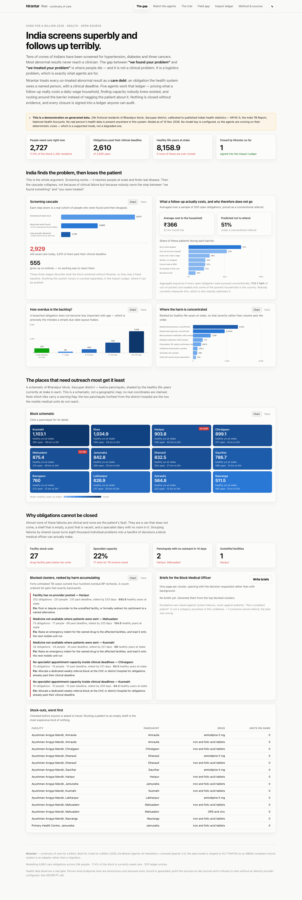
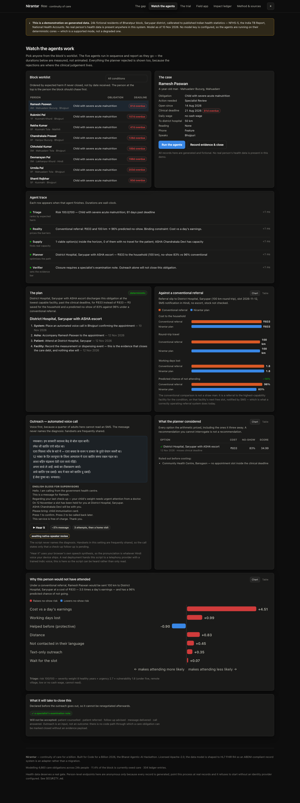
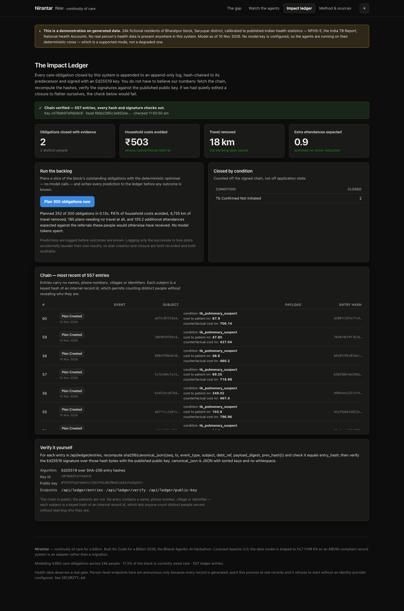
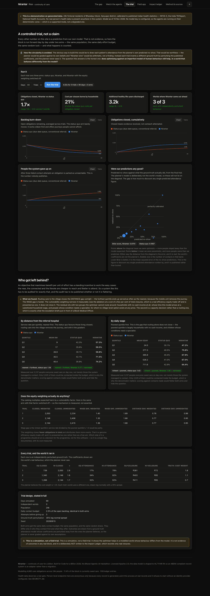
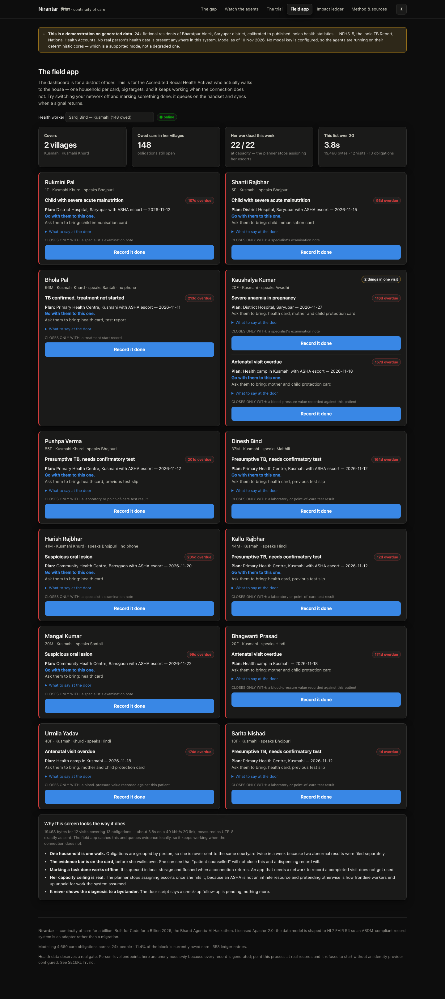

# Nirantar — निरंतर

**Continuity of care for a billion.**

India screens superbly and follows up terribly. Nirantar is an agentic system
that closes the gap.

Built for **Code for a Billion 2026**, the Bharat Agentic-AI Hackathon.
Track: **Health**.

[](https://github.com/VamsiKrishnaThota03/nirantar/actions/workflows/ci.yml)
[](LICENSE)




---

## The problem

Tens of crores of Indians have been screened for hypertension, diabetes and
three cancers under the population-based screening programme at Ayushman
Arogya Mandirs. The screening works. It reaches people at enormous scale and
it finds real disease.

Then the cascade collapses. Roughly **one in eight** Indian adults with
hypertension has it controlled. Not because the diagnosis was wrong, and not
because the medicine does not exist — amlodipine costs rupees — but because
nobody owns the step between *"we found your problem"* and *"we treated your
problem"*.

**That gap is not a clinical problem. It is a logistics problem**, which is
exactly the kind of problem agents are good at.

### Why reminder systems do not fix it

Nobody skips a follow-up because they forgot. They skip it because:

| The referral slip says | What it actually costs |
|---|---|
| "Report to the District Hospital" | ₹400 of lost daily wage |
| "Next available slot: in 3 weeks" | ₹120 of bus fare, twice if an escort is needed |
| "Bring this slip" | a full working day, sometimes two |
| (silent on stock) | and the amlodipine is out of stock when you arrive |

Out-of-pocket spending is about **47% of all Indian health expenditure**.
Conventional referral software prices a follow-up visit at **zero rupees and
zero risk**, then records non-attendance as the patient's failure of
motivation. An SMS saying "please visit the district hospital" is not a
health intervention. It is a compliance artefact.

---

## What Nirantar does

Every un-treated abnormal result becomes a **care debt**: an obligation the
health system owes a *named person*, with a *clinical deadline*. Five agents
work that ledger.

| Agent | What it does | Who decides |
|---|---|---|
| **Triage** | Ranks by expected harm — clinical severity × deadline proximity × vulnerability | Deterministic formula. The model may adjust ±12 and can **never** de-prioritise a critical case. |
| **Reality** | Prices what a conventional referral really costs this household, and predicts whether they will attend | Deterministic cost + logistic model. The model writes the narrative. |
| **Supply** | Finds every venue that can actually discharge the obligation in time, with the drug in stock | **No model at all.** A hallucinated appointment slot puts a sick person on a bus for nothing. |
| **Planner** | Solves for the cheapest path that still discharges the obligation | Constrained optimiser. The model picks among the top three and writes the outreach; it cannot invent an option, move a date, override stock, or trade away a deadline. |
| **Verifier** | Sets and enforces the evidence bar for closure | Entirely deterministic. The model may flag an entry as implausible for human audit; it cannot permit or block a closure. |

Aged-out clusters escalate to the Block Medical Officer as a one-page brief
that opens with the decision requested.

### The actual output, for one real case from the demo

A 25-year-old man in Gaurihar Tola. Confirmed TB, treatment never started,
**75 days past the clinical deadline**. No phone in the household. Speaks
Santali. Earns ₹643 on a day he works.

```
Conventional referral   →  Community Health Centre, 13 km round trip
                           ₹747  ·  1.0 working day lost  ·  58% predicted no-show
                           SMS in Hindi. Stock not checked.

Nirantar plan           →  Primary Health Centre, Chiraigaon, with ASHA escort
                           ₹420  ·  0.6 working days  ·  13% predicted no-show
                           Anti-TB FDC reserved before he is asked to travel.
                           ASHA walks to the house — he has no phone, so there
                           is no electronic way to reach him.
```

₹327 back in the household, and the chance he actually starts treatment goes
from 42% to 87%.



Three details in there matter more than the headline:

1. **It would not let a mobile van start TB treatment.** A van with a medical
   officer aboard is cheaper and closer, and the optimiser wanted it — but
   initiating TB treatment means registering the patient on the national
   programme. The venue must genuinely be able to do the thing. Cheap only
   wins where the care is equivalent.
2. **It did not claim to have reached him in his language.** We have
   hand-written outreach copy in Hindi and Bhojpuri; we have none in Santali.
   So the call goes out in Hindi, it is flagged, and the attendance model
   **keeps the language penalty** — which is why the prediction is 13% and not
   8%. Claiming a barrier you have not removed is how pilots inflate results.
3. **It noticed he has no phone** and routed outreach to a human being at the
   door. If no ASHA had capacity that week, the plan would be marked
   *undeliverable* and escalated as a contact-channel failure rather than
   recorded as outreach.

---

## The Impact Ledger

Judging weights **proven impact at 25%** and asks for deployment data, not
intentions. So measurement is a first-class feature rather than a slide.

Every state change on a care debt is appended to a hash-chained,
**Ed25519-signed** append-only log. Fetch the chain, recompute the hashes,
verify the signatures against the published public key. If we quietly edited a
closure to flatter ourselves, verification breaks loudly.

```bash
curl -s localhost:8000/api/ledger/verify | jq '{valid, entries, key_id}'
curl -s localhost:8000/api/ledger/public-key
curl -s localhost:8000/api/ledger/entries | jq '.entries[-1]'
```

Four properties worth noting:

- **Predictions are logged before outcomes are known.** Plan creation and
  closure are both recorded. Logging only the successes is how pilots
  accidentally launder their own results.
- **Nothing closes without evidence.** A blood-pressure *value*, a dispensing
  record, a test result, a treatment start date. "Patient counselled",
  "referred", "follow-up advised", "message delivered" — none of these close
  anything, and there is **no API through which a care debt can be marked
  closed without an evidence payload**. That absence is the feature.
- **The chain is public; the patients are not.** No entry contains a name,
  phone number, village or identifier. Each subject is a keyed hash of an
  internal record id, so anyone can count distinct people served without
  learning who they are. Enforced by a field allowlist in code, with a test
  that tries to leak a name and asserts it was dropped.
- **Resetting the demo world does not touch the ledger.** That asymmetry is
  the whole point.



---

## Does it actually work? A controlled trial

The Impact Ledger records what the system *did*. But everything above is
still our model talking about itself, and a reader is entitled to ask whether
the model is worth anything. So the block is run forward ninety days under two
arms — same population, same daily effort budget, same random luck:

* **Status quo** — the backlog worked oldest-first, each patient given a
  conventional referral to the highest-capability facility on its next free
  slot, notified by SMS.
* **Nirantar** — same effort, but ranked by expected harm and routed by the
  optimiser.

**The circularity problem, and how it is handled.** The obvious way to build
this would be to draw each patient's attendance from the planner's own
predicted no-show. That is worthless — the planner would be graded against
its own beliefs and "Nirantar wins" would be arithmetic, not a finding.
Instead each trial invents a **different ground truth** by perturbing the
published coefficients log-normally (±35%), and the planner never sees it. The
question the trial answers is the honest one:

> Does optimising against an *imperfect* model of human behaviour still help,
> in a world whose real behaviour differs from the model?

Across three independently perturbed worlds, 90 days each:

| | Status quo | Nirantar |
|---|---|---|
| Obligations closed | 739 – 1,340 | 2,050 – 2,148 |
| Attendance per contact | 17 – 34% | 78 – 92% |
| Cost per closure, to the household | ₹381 – ₹411 | ₹72 – ₹85 |
| People given up on as unreachable | 1,255 | 541 |

Median **1.7× more obligations closed** at **21% of the household cost per
closure**, and Nirantar came out ahead in every world. The code also publishes
a **reliability diagram and Brier score** — predicted no-show against what the
ground truth actually did — so you can see how wrong the predictions were
rather than taking them on trust.



Run it yourself: the **The trial** tab, or `POST /api/trial`. It takes about
two seconds per trial, and it is deliberately **not** written to the Impact
Ledger: simulated outcomes must never be mixed into the signed record of real
closures.

## Who gets left behind?

An objective that maximises benefit per unit of effort has a standing
incentive to work the easy cases — the near, the connected and the literate
are cheaper to reach and likelier to attend. A system like this has to be
audited for exactly that, so the audit ships with it and is published whether
or not it flatters us.

Service rate over **everyone owed care** (not merely those contacted):

| Gap | Status quo | Nirantar |
|---|---|---|
| Nearest ÷ furthest quintile | **1.18** | **0.95** — closed |
| Richest ÷ poorest quintile | **1.42** | **1.40** — essentially unchanged |

**What we found, including the part we did not want to find.** Routing care
into the village closes the *distance* gap outright: the furthest quintile
ends up served as often as the nearest, because the mobile unit removes the
journey. The *wage* gap is harder. A vulnerability multiplier in the ranking
narrows it measurably — 1.69 → 1.40 in the ablation — at a cost of about 6% of
total closures, which is a real efficiency–equity trade-off and is presented
as one rather than as a free win. It does not close it. The residual sits with
two groups the optimiser cannot route around: households with no cash income,
whose time this model prices at a substituted household wage, and people whose
condition needs a specialist, for whom no village-level option exists at any
price. **The second is a capacity decision, not a routing one** — which is
exactly what the escalation briefs put in front of a Block Medical Officer.

That ablation is a single documented flag with its cost measured, because
which side of that trade-off a programme should sit on is a decision for the
programme, not for this software.

## The field app

A district dashboard is for someone with a laptop and a desk. The ASHA has
neither: she covers about a thousand people, is paid per completed task, and
is reading this on a sub-₹8,000 handset over a connection that drops. So the
**Field app** tab plays by different rules.

* **Offline first.** Her queue is cached on the handset and evidence is queued
  in local storage when there is no signal, then flushed when one returns. A
  service worker caches the app shell so the page opens with no connection at
  all. An app that needs a network to record a completed visit does not get
  used.
* **One household is one walk.** Obligations are grouped by person, so she is
  never sent to the same courtyard twice in a week because two abnormal
  results were filed separately.
* **The evidence bar is on the card**, before she sets off — she can see that
  "patient counselled" will not close it and a dispensing record will.
* **Her capacity ceiling is real.** The planner stops assigning her escorts
  once she hits it, because an ASHA is not an infinite resource.
* **~1.6 KB per household**, about 3.8 s for a full queue on a 40 kbit/s 2G
  link, measured as UTF-8 exactly as sent. The supervisor-facing English gloss
  is deliberately not shipped to the field.



## Running it

Needs Python 3.12+ and Node 18+.

```bash
# backend
cd backend
python3 -m venv .venv && ./.venv/bin/pip install -r requirements.txt
./.venv/bin/python -m uvicorn nirantar.main:app --host 127.0.0.1 --port 8000

# frontend (second terminal)
cd frontend
npm install
npm run build          # the backend then serves it at http://127.0.0.1:8000
# or: npm run dev      # hot-reloading dev server on 127.0.0.1:5173
```

Open **http://127.0.0.1:8000**. Or with Docker:

```bash
docker compose up --build    # publishes to 127.0.0.1:8000 only
```

### Optional: connect Claude

```bash
export ANTHROPIC_API_KEY=sk-ant-...
```

**Everything works without it.** Every agent has a complete deterministic
core, so with no key the system degrades to *slightly less eloquent* — never
to *unsafe*, and never to *offline*. A village health worker's tablet does not
get to depend on an API being up.

This is also the honest answer to "does this scale?". A block of 200,000
people cannot afford a model call per follow-up, and this design does not
require one: the optimiser planned **300 care obligations in 0.15 seconds with
zero model calls**. The model is spent only on the handful of artefacts a human
actually reads — a plan rationale, a dialect script, a brief for a medical
officer.

### Tests

```bash
cd backend && ./.venv/bin/python -m pytest tests -q     # 101 passed
cd frontend && npm run build                            # typecheck + build
```

The suite is mostly adversarial. It asserts that a mobile van can never
initiate TB treatment, that a refill is never routed to an empty shelf, that
a patient with no phone is never promised a WhatsApp message, that backdated
and wrong-typed evidence cannot close an obligation, that editing or forging a
ledger row breaks verification, that concurrent writers cannot fork the hash
chain, and that **the process refuses to start** if configured for real
records without an identity provider.

The trial has its own tests, because a simulation that flatters its own system
is worse than no simulation — it launders an assumption into something that
looks like evidence. So the suite checks that the ground-truth coefficients
really are perturbed away from the planner's, that both arms get the same
effort budget, that **the status-quo arm is not a straw man** (its attendance
rate must land in a defensible band), that capacity still binds, that a trial
never writes to the ledger or mutates the live world, and that the equity
weighting measurably changes who gets served.

Two tests exist purely to keep the project honest:
`test_ncd_follow_up_is_far_worse_than_tb` fails the build if the simulated
cascade stops reproducing India's actual follow-up gap, and
`test_every_constant_declares_its_provenance` fails if any constant lacks a
source or an explained assumption.

---

## The data

**Every record is fictional. No real person's health data is anywhere in this
system.** The generated block — 24,000 residents of Bharatpur block, Saryupar
district — is calibrated to published Indian statistics so it *behaves* like a
real block: NFHS-5 for prevalence and anaemia, India TB Report 2023 for
notifications and initial loss to follow-up, National Health Accounts for
out-of-pocket share, Labour Bureau for rural wages.

The generated world deliberately starts in a bad state — ~2,900 open
obligations, most already past their deadline, two remote panchayats the
mobile units never reach — because that is the honest starting condition of
Indian primary care after a decade of successful mass screening with no
closing mechanism. You cannot demonstrate burning down a backlog you did not
model.

Every constant, including the ones we had to **assume**, is served at
`/api/calibration` and listed in the dashboard's *Method & sources* tab. See
[`docs/DATA_SOURCES.md`](docs/DATA_SOURCES.md) and the honest
[limits of this work](docs/DATA_SOURCES.md#limits-of-this-work).

---

## Security

Health data deserves a real gate, so this is not a later milestone.

- **Config defaults to loopback.** `HOST` defaults to `127.0.0.1`; only a
  container platform's own proxy sets a wildcard bind.
- **Two audiences, split in code.** The landing page and the Impact Ledger are
  *intentionally* anonymous — an impact record only we can read proves
  nothing. Everything touching person-level records is gated.
- **Fail-closed on real data.** With `DEMO_MODE=false` the process **refuses
  to start** without an OIDC provider configured. There is no code path where a
  missing configuration becomes an open door.
- **No invented auth.** No Nirantar password, no Nirantar API key, no
  self-signed session token. Tokens are verified against your organisation's
  existing identity provider via PyJWT and its published JWKS.

Full detail and the deployment checklist: [`SECURITY.md`](SECURITY.md).

---

## Adoption path

The data model is shaped to **HL7 FHIR R4** (`Patient`, `Observation`,
`Location`, `Practitioner`), so for a state programme already running an
ABDM-compliant record system this is an adapter, not a migration. Care debts
are derived from `Observation` resources that already exist in the NCD portal
today — which is the point. **Nirantar does not need new data collection. The
abnormal results are already sitting there.**

## Repository

```
backend/nirantar/
  calibration.py    published constants, each with its source
  behaviour.py      what a visit costs, and who therefore does not attend
  models.py         the domain model, FHIR-shaped
  simulation.py     the controlled trial, equity audit and calibration
  ledger.py         hash-chained Ed25519 impact ledger
  security.py       the gate
  agents/           triage · reality · supply · planner · verifier · escalation
  ivr/              outreach copy, Devanagari, with English glosses
  data/generator.py the calibrated synthetic block
frontend/src/       dashboard, agent theatre, trial, field app, ledger audit
frontend/public/    service worker (app shell only; never caches /api)
docs/               architecture · judging · data sources · deploy · demo script
```

Further reading: [`docs/ARCHITECTURE.md`](docs/ARCHITECTURE.md) ·
[`docs/JUDGING.md`](docs/JUDGING.md) ·
[`docs/DEMO_SCRIPT.md`](docs/DEMO_SCRIPT.md) ·
[`docs/DEPLOY.md`](docs/DEPLOY.md)

---

*Think local. Hack global.* Every line open-source, for the nation to use.
